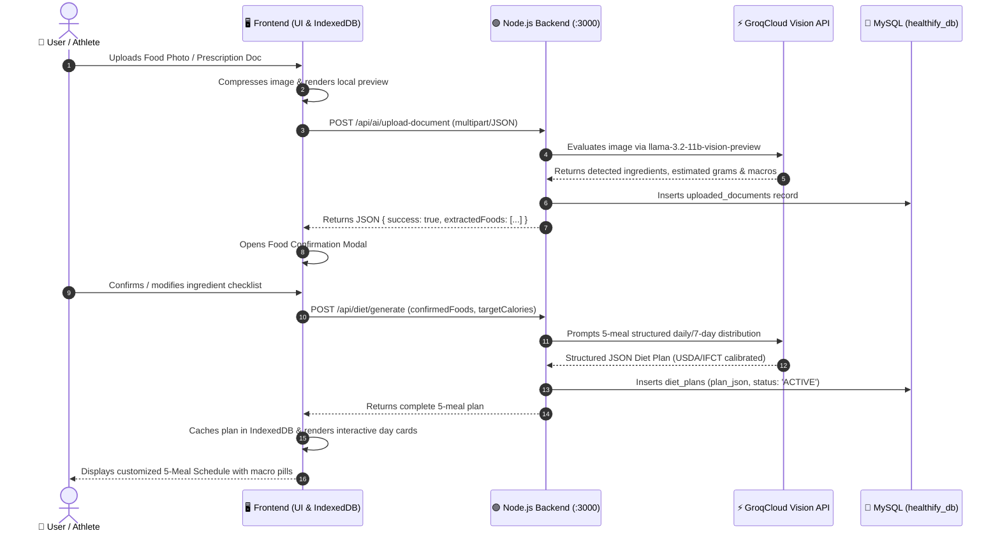
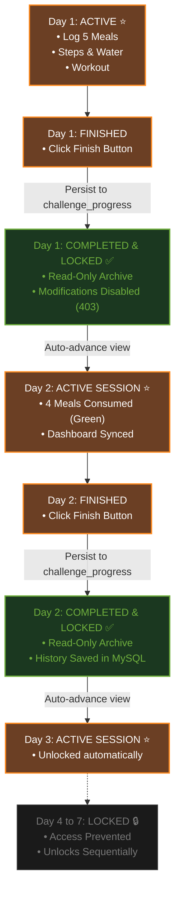

# Healthify AI Diet Studio

> **AI-Powered Diet, Nutrition & Fitness Tracking Platform**  
> *A high-performance full-stack health intelligence ecosystem featuring multimodal food vision analysis, 5-meal personalized diet generation, dual-backend architecture, and a 25-day sequential transformation challenge.*

[](https://github.com/Charan-8879/diet-and-nutrition)
[](https://developer.mozilla.org/en-US/docs/Web/JavaScript)
[](https://getbootstrap.com/)
[](https://nodejs.org/)
[](https://spring.io/projects/spring-boot)
[](https://www.mysql.com/)
[](https://groq.com/)
[-008080?style=for-the-badge)](https://fdc.nal.usda.gov/)

---

## 📑 Table of Contents

- [1. Project Overview](#1-project-overview)
- [2. Key Features](#2-key-features)
- [3. Technology Stack](#3-technology-stack)
- [4. System Architecture](#4-system-architecture)
- [5. Architecture Flowcharts](#5-architecture-flowcharts)
  - [5.1 Full-Stack System Architecture](#51-full-stack-system-architecture)
  - [5.2 Multimodal AI Food & Vision Analysis Workflow](#52-multimodal-ai-food--vision-analysis-workflow)
- [6. Application Workflow](#6-application-workflow)
- [7. AI Diet Studio Workflow](#7-ai-diet-studio-workflow)
- [8. Sequential 7-Day & 25-Day Challenge Workflow](#8-sequential-7-day--25-day-challenge-workflow)
- [9. Database Architecture](#9-database-architecture)
- [10. Backend API Architecture (Dual-Backend Design)](#10-backend-api-architecture-dual-backend-design)
- [11. Project Folder Structure](#11-project-folder-structure)
- [12. Installation & Setup Guide](#12-installation--setup-guide)
- [13. Environment Variables](#13-environment-variables)
- [14. Running the Application](#14-running-the-application)
- [15. Complete API Reference](#15-complete-api-reference)
- [16. User Interface & Theme System](#16-user-interface--theme-system)
- [17. Security & Resilience Considerations](#17-security--resilience-considerations)
- [18. Future Enhancements](#18-future-enhancements)
- [19. Author & License](#19-author--license)

---

## 1. Project Overview

**Healthify AI Diet Studio** is an enterprise-grade fitness, diet, and nutrition tracking platform engineered for high performance, accuracy, and ease of use. It solves the fragmentation common in traditional fitness apps by unifying:

1. **Multimodal Clinical Ingestion**: Seamless parsing of doctor/dietitian prescriptions and lab reports via Optical Character Recognition (OCR) and Vision Language Models.
2. **Computer Vision Food Recognition**: Automatic identification of meal items from photos with confidence badges, calibrated gram weights, and verified nutritional breakdowns.
3. **5-Meal Structured Diet Generation**: Personalized distribution across 5 daily windows (*Breakfast, Pre-Lunch, Lunch, Evening Snack, Dinner*) tailored to individual Basal Metabolic Rate (BMR) and Total Daily Energy Expenditure (TDEE).
4. **Sequential Day Locking Engine**: Strict challenge progression preventing skip-aheads, enforcing permanent locking of completed days in read-only archive mode, and activating upcoming days sequentially.
5. **Dual-Backend Agility**: Full interoperability between a **Node.js/Express** microservice and an enterprise **Java 21 / Spring Boot 3.3** backend, operating against a unified **MySQL** database schema.
6. **Quota-Guarded Storage**: A zero-bloat browser storage design combining **IndexedDB** for heavy plans and media with **localStorage** for sessions, preventing browser quota crashes.

---

## 2. Key Features

### 🥗 AI Diet Studio & Multimodal Vision
- **Vision-Powered Food Logging**: Upload photos of meals; the AI vision engine identifies individual food items, estimates portion sizes in grams, and maps macronutrients.
- **Doctor / Trainer Prescription Extraction**: Upload scanned prescription PDFs or images. The engine extracts target calorie limits, dietary restrictions, and clinical recommendations.
- **Confirmed Foods Curation**: An interactive ingredient checklist where users verify available foods before the AI generates a customized 5-meal plan.
- **Natural Language Plan Modification**: Refine generated plans conversationally (e.g., *"Replace oats with scrambled eggs"* or *"Make Day 2 strictly vegetarian"*).
- **One-Click Direct Print**: Export formatted, print-ready meal schedules with preparation instructions and macro summaries.

### 🎯 Scientific Nutritional Intelligence
- **Mifflin-St Jeor Formula**: Accurate BMR and TDEE calculations factoring in age, gender, height, weight, and activity multipliers (1.2 to 1.9).
- **Target Goals**: Tailored caloric deficits and surpluses for *Muscle Building, Fat Loss, Maintenance, and Endurance*.
- **Verified Nutrition Standards**: Macro and micronutrient reference values calibrated against the **ICMR-NIN Indian Food Composition Tables (IFCT)** and the **USDA FoodData Central** database.
- **5 Daily Meal Slots**: Structured distribution guaranteeing balanced protein synthesis and stable blood glucose throughout the day.

### 🏆 25-Day Transformation Challenge & Sequential Day Locking
- **4 Daily Execution Pillars**: Tracks steps, hydration, daily workouts, and meal consumption.
- **Sequential Day Progression**:
  - **Active Day**: Meal logging, tracking, and consumption updates are fully unlocked.
  - **Completed Day**: Marked as `Archived` upon clicking **Finish**, locking the day into an immutable read-only state.
  - **Upcoming Days**: Locked with access prevented until previous days are finalized.
- **Backend Validation**: Enforces day locking at the API layer, rejecting unauthorized edits with `HTTP 403 Forbidden`.
- **Session Continuity**: Retains all completed meal checks, calories, and protein totals across logout/login and browser reloads.

### 🏋️ Complete Workout Hub & Supplement Tracker
- **Workout Modes**: Support for **Home Workouts**, **Gym Workouts**, and scheduled **Rest Days**.
- **Muscle-Targeted Routines**: Chest, back, legs, shoulders, arms, and core with exercise lists, recommended sets/reps, and video technique guides.
- **Supplement Scheduler**: Tracks creatine, whey protein, pre-workouts, and multivitamins with timing instructions and serving dosages.

### ⚡ Resilient Client-Side Architecture
- **Dual-Layer Hybrid Storage**: Utilizes an asynchronous IndexedDB store (`HealthifyDB`) for chat history, attachments, and diet plans, paired with scoped localStorage keys for instant session restoration.
- **Offline Sync Queue**: Queues meal consumption and challenge completions when offline and automatically syncs to MySQL when reconnected.

---

## 3. Technology Stack

| Layer | Technologies | Description |
|---|---|---|
| **Frontend** | HTML5, CSS3, JavaScript (ES6+) | Single-page application architecture with zero framework overhead |
| **UI Framework** | Bootstrap 5.3, Bootstrap Icons | Responsive dark theme with custom orange/green glassmorphism styling |
| **Client Storage** | IndexedDB (`HealthifyDB`), Web Storage | Quota-safe offline cache for bulky plan JSONs and chat turn history |
| **Node.js Backend** | Express 4.19, `mysql2/promise`, `dotenv`, `cors` | Asynchronous REST backend running on port `3000` |
| **Java Backend** | Java 21, Spring Boot 3.3.4, Spring Data JPA, Hibernate | Enterprise REST API service running on port `8080` |
| **Database** | MySQL 8.0 / MariaDB | Relational persistence with 12 structured normalized tables |
| **AI Models** | GroqCloud: `openai/gpt-oss-120b`, `llama-3.2-11b-vision-preview` | Low-latency inference for multimodal vision and health coaching |
| **Data Sources** | USDA FoodData Central, ICMR-NIN IFCT | Standardized nutrient reference databases |

---

## 4. System Architecture

Healthify is engineered around an **asymmetric dual-backend architecture**. Both backends can run independently or in parallel against the central **MySQL** database (`healthify_db`):

```
┌────────────────────────────────────────────────────────────────────────┐
│                          PRESENTATION LAYER                            │
│           HTML5  •  CSS3 (Dark Theme)  •  Vanilla ES6+ JavaScript       │
│      Bootstrap 5.3  •  Chart.js Graphs  •  IndexedDB (HealthifyDB)     │
└──────────────────┬─────────────────────────────────┬───────────────────┘
                   │                                 │
                   ▼ (Port 3000)                     ▼ (Port 8080)
┌──────────────────────────────────┐┌────────────────────────────────────┐
│      NODE.JS / EXPRESS API       ││     JAVA SPRING BOOT REST API      │
│  • Express 4 Router              ││  • Spring Boot 3.3 / Java 21       │
│  • GroqCloud AI SDK              ││  • Spring Data JPA / Hibernate     │
│  • Vision Image Ingestion        ││  • Jackson Polymorphic DTOs        │
│  • MySQL2 Async Connection Pool  ││  • MySQL Hikari Connection Pool    │
│  • Sequential Locking Checks     ││  • Challenge & Tracking Services   │
└──────────────────┬───────────────┘└────────────────┬───────────────────┘
                   │                                 │
                   └────────────────┬────────────────┘
                                    ▼
┌────────────────────────────────────────────────────────────────────────┐
│                        PERSISTENCE LAYER (MySQL)                       │
│  users • user_profiles • diet_plans • diet_meal_consumptions          │
│  challenge_progress • food_logs • daily_steps • water_intake • workouts│
└───────────────────────────────────┬────────────────────────────────────┘
                                    ▼
┌────────────────────────────────────────────────────────────────────────┐
│                       EXTERNAL COGNITIVE SERVICES                      │
│      GroqCloud API  •  Llama 3.2 11B Vision  •  GPT-OSS 120B Chat      │
└────────────────────────────────────────────────────────────────────────┘
```

---

## 5. Architecture Flowcharts

### 5.1 Full-Stack System Architecture

```mermaid
flowchart TD
    subgraph Client ["Client Browser (Desktop, Tablet, Mobile)"]
        User(["👤 Athlete / User"])
        UI["🖥️ Presentation Layer\n(HTML5, CSS3, ES6+ JS, Bootstrap 5.3)"]
        IDB[("🗄️ IndexedDB (HealthifyDB)\n• Large Plans & Offline Queue")]
        LS[("💾 localStorage\n• Session & Daily Cache")]
    end

    subgraph DualBackends ["Dual Backend REST Layer"]
        NodeServer["🟢 Node.js / Express Server\n(Port 3000)\n• AI Coach & Vision Ingestion\n• Challenge & Meal Endpoints"]
        SpringServer["☕ Java Spring Boot Server\n(Port 8080)\n• JPA Enterprise Services\n• Auth & Nutrition Logic"]
    end

    subgraph Database ["MySQL Relational Store (healthify_db)"]
        DB[("🐬 MySQL Database\n• users & profiles\n• diet_plans & consumptions\n• challenge_progress\n• food_logs & workouts")]
    end

    subgraph AIService ["External AI Intelligence"]
        GroqAPI["⚡ GroqCloud AI API\n• llama-3.2-11b-vision-preview\n• openai/gpt-oss-120b"]
    end

    User -->|Interacts with UI| UI
    UI <-->|Cache heavy objects| IDB
    UI <-->|Session tokens| LS
    UI -->|REST API Calls (Port 3000)| NodeServer
    UI -->|REST API Calls (Port 8080)| SpringServer

    NodeServer <-->|SQL Queries| DB
    SpringServer <-->|Spring Data JPA| DB

    NodeServer -->|Multimodal Vision & Chat| GroqAPI
    SpringServer -.->|Optional AI Bridge| GroqAPI

    NodeServer -->|JSON Response| UI
    SpringServer -->|JSON Response| UI
    UI -->|Updates DOM| User
```

---

### 5.2 Multimodal AI Food & Vision Analysis Workflow



---

## 6. Application Workflow

```
1. REGISTRATION & AUTHENTICATION
   ├── Real-time phone availability check via /api/auth/check-phone
   ├── Password verification & minimal session creation (ht_currentUser)
   └── Automatic restoration of cached profile & active challenge day

2. PROFILE & GOAL CALIBRATION
   ├── Inputs: Age, Gender, Height (cm), Weight (kg), Activity Level
   ├── Output: BMR, TDEE, Calorie Deficit/Surplus target
   └── Target Goal: Muscle Building, Fat Loss, Maintenance, or Endurance

3. DAILY TRACKING (4 EXECUTION PILLARS)
   ├── Steps Tracker: Interactive modal, step goal progress bar
   ├── Hydration Tracker: 250ml glass logger vs target glasses
   ├── Workout Session: Home or Gym routine check-off
   └── Nutrition Logging: Direct search log OR Diet Plan consumption

4. FITNESS CHALLENGE PROGRESSION
   ├── Dashboard indicates current view vs active challenge day
   ├── User clicks "Complete Day & Mark Challenge" (Finish)
   └── Day is evaluated, archived, locked, and next day activates
```

---

## 7. AI Diet Studio Workflow

The AI Diet Studio operates in six progressive stages:

1. **Input Stage**: The user enters an ingredient list, prompts the conversational coach, or uploads an image/document (JPEG, PNG, WEBP, PDF).
2. **Vision & OCR Processing**: The document is analyzed using `llama-3.2-11b-vision-preview` to detect food items, quantities, and doctor notes.
3. **Food Confirmation Modal**: Detected foods appear in an interactive checklist. Users can delete unrecognized items, adjust gram weights, or add missing pantry ingredients.
4. **Caloric Calibration**: Confirmed ingredients are reconciled against the user's TDEE target (from their Profile Calculator) or doctor prescription limits.
5. **5-Meal Plan Generation**: The system schedules meals across 5 dedicated slots:
   - 🌅 **Breakfast** (approx. 25% daily kcal)
   - 🥗 **Pre-Lunch Snack** (approx. 10% daily kcal)
   - 🍛 **Lunch** (approx. 35% daily kcal)
   - 🥜 **Evening Snack** (approx. 10% daily kcal)
   - 🍲 **Dinner** (approx. 20% daily kcal)
6. **Execution & Real-Time Sync**: As the user marks meals as consumed (`✅ Mark Consumed`), the backend bakes the consumption into `diet_plans.plan_json` and updates the active dashboard in real-time.

---

## 8. Sequential 7-Day & 25-Day Challenge Workflow

The application enforces a **strict sequential progression** across all challenge days:



### Day State Rules

| State | Status Badge | Meal Modification | Dashboard State | Navigation |
|---|---|---|---|---|
| **Completed Day** | `✅ Archived` | **Disabled** (Read-Only) | Historical summary displayed | Viewable anytime |
| **Active Day** | `⭐ In Progress` | **Enabled** (`Mark Consumed`, `Skip`) | Active live counters updated | Primary default view |
| **Upcoming Day** | `🔒 Locked` | **Disabled** | Hidden until unlocked | Access blocked |

---

## 9. Database Architecture

The MySQL database (`healthify_db`) consists of **12 normalized relational tables**:

```
                                  ┌────────────────┐
                                  │     users      │
                                  └───┬────────────┘
                                      │ 1
                                      │
         ┌──────────────┬─────────────┼──────────────┬──────────────┬─────────────┐
         │ 1            │ 1           │ 1            │ 1            │ 1           │ 1
         ▼              ▼             ▼              ▼              ▼             ▼
  ┌──────────────┐┌────────────┐┌────────────┐┌─────────────┐┌────────────┐┌─────────────┐
  │user_profiles ││diet_plans  ││ daily_steps││water_intake ││workout_logs││challenge_   │
  └──────────────┘└──────┬─────┘└────────────┘└─────────────┘└────────────┘│ progress    │
                         │ 1                                               └─────────────┘
                         │
                         ▼ N
           ┌────────────────────────────┐
           │   diet_meal_consumptions   │
           └────────────────────────────┘
```

### Table Specifications

#### 1. `users`
Core authentication and user registry.
- `id` (BIGINT, PK, Auto-Increment)
- `name` (VARCHAR 100, NOT NULL)
- `email` (VARCHAR 150, UNIQUE, NOT NULL)
- `password` (VARCHAR 255)
- `phone` (VARCHAR 30)
- `created_at`, `updated_at` (DATETIME)

#### 2. `user_profiles`
Metabolic and biometric calculations (1-to-1 with `users`).
- `id` (BIGINT, PK)
- `user_id` (BIGINT, UNIQUE, FK -> `users.id`)
- `age`, `gender`, `height`, `weight`, `activity` (DOUBLE)
- `bmr`, `tdee`, `target_calories` (DOUBLE)
- `selected_goal` (VARCHAR 100)
- `confirmed_foods_json` (LONGTEXT)
- `updated_at` (DATETIME)

#### 3. `diet_plans`
Structured 5-meal daily, 7-day, or 25-day meal plans.
- `id` (BIGINT, PK)
- `user_id` (BIGINT, FK -> `users.id`)
- `title` (VARCHAR 200, NOT NULL)
- `plan_type` (VARCHAR 50) — `DAILY`, `7_DAY`, `25_DAY`
- `goal` (VARCHAR 100), `calorie_target` (DOUBLE)
- `protein_target`, `carbs_target`, `fat_target`, `fibre_target` (DOUBLE)
- `plan_json` (LONGTEXT) — Complete serialized days and meals array
- `confirmed_foods_json` (LONGTEXT)
- `doctor_notes` (TEXT)
- `status` (VARCHAR 50) — `ACTIVE`, `ARCHIVED`
- `created_at`, `updated_at` (DATETIME)

#### 4. `diet_meal_consumptions`
Granular record of individual meal slot consumptions.
- `id` (BIGINT, PK)
- `user_id` (BIGINT, FK -> `users.id`)
- `plan_id` (BIGINT, FK -> `diet_plans.id`)
- `day_number` (INT)
- `meal_slot` / `meal_type` (VARCHAR 50) — `BREAKFAST`, `PRE_LUNCH`, `LUNCH`, etc.
- `meal_name` (VARCHAR 150)
- `planned_cal`, `planned_protein`, `planned_carbs`, `planned_fat`, `planned_fibre` (DOUBLE)
- `actual_cal`, `actual_protein`, `actual_carbs`, `actual_fat`, `actual_fibre` (DOUBLE)
- `status` (VARCHAR 30) — `CONSUMED`, `SKIPPED`
- `log_date` (VARCHAR 30)
- `consumed_at` (DATETIME)

#### 5. `challenge_progress`
Tracks the 25-Day Transformation Challenge state (1-to-1 with `users`).
- `id` (BIGINT, PK)
- `user_id` (BIGINT, UNIQUE, FK -> `users.id`)
- `total_days` (INT, default 25)
- `current_day` (INT)
- `start_date` (VARCHAR 50)
- `history_json` (LONGTEXT) — Serialized records of all completed days
- `updated_at` (DATETIME)

#### 6. `food_logs`
Itemized daily food entries.
- `id` (BIGINT, PK)
- `user_id` (BIGINT, FK -> `users.id`)
- `name` (VARCHAR 150, NOT NULL)
- `grams`, `cal`, `protein`, `fibre` (DOUBLE)
- `type` (VARCHAR 50) — `food`, `diet_plan`
- `log_date` (VARCHAR 30)
- `created_at` (DATETIME)

#### 7. `daily_steps`
Daily step tracking and step goals.
- `id` (BIGINT, PK)
- `user_id` (BIGINT, FK -> `users.id`)
- `steps_count` (INT, NOT NULL)
- `step_goal` (INT, NOT NULL, default 10000)
- `log_date` (VARCHAR 30, NOT NULL)
- `updated_at` (DATETIME)

#### 8. `water_intake`
Daily hydration in 250ml glasses.
- `id` (BIGINT, PK)
- `user_id` (BIGINT, FK -> `users.id`)
- `glasses` (INT, NOT NULL)
- `target_glasses` (INT)
- `log_date` (VARCHAR 30, NOT NULL)
- `updated_at` (DATETIME)

#### 9. `workout_logs`
Workout session logs.
- `id` (BIGINT, PK)
- `user_id` (BIGINT, FK -> `users.id`)
- `workout_mode` (VARCHAR 50) — `home`, `gym`, `none`
- `workout_title` (VARCHAR 150)
- `trained_muscles` (VARCHAR 255)
- `exercises_json` (TEXT)
- `completed` (BIT(1))
- `log_date` (VARCHAR 30)
- `created_at` (DATETIME)

#### 10. `ai_chat_messages`
Conversational chat turn history with AI Coach.
- `id` (BIGINT, PK)
- `user_id` (BIGINT, FK -> `users.id`)
- `sender` (VARCHAR 10) — `user`, `bot`
- `message_text` (MEDIUMTEXT, NOT NULL)
- `source` (VARCHAR 50) — `groq`, `system`, `grounded`
- `diet_plan_id` (BIGINT)
- `has_attachment` (TINYINT(1)), `attachment_name` (VARCHAR 255), `attachment_type` (VARCHAR 100)
- `created_at` (DATETIME)

#### 11. `uploaded_documents`
Clinical prescriptions, documents, and meal photos.
- `id` (BIGINT, PK)
- `user_id` (BIGINT, FK -> `users.id`)
- `file_name` (VARCHAR 255), `file_type` (VARCHAR 100), `file_size` (BIGINT)
- `storage_provider` (VARCHAR 50)
- `file_url` (TEXT, NOT NULL)
- `extracted_foods_count` (INT)
- `uploaded_at` (DATETIME)

#### 12. `supplements`
Athlete supplement schedule and dosages.
- `id` (BIGINT, PK)
- `user_id` (BIGINT, FK -> `users.id`)
- `name` (VARCHAR 150, NOT NULL)
- `brand` (VARCHAR 150)
- `serving_size` (VARCHAR 50), `cal` (DOUBLE), `protein` (DOUBLE)
- `instructions` (TEXT)
- `created_at` (DATETIME)

---

## 10. Backend API Architecture (Dual-Backend Design)

Healthify provides two interoperable backend services designed to communicate with the same MySQL schema:

```
                  ┌───────────────────────────────┐
                  │      HEALTHIFY FRONTEND       │
                  │   BACKEND_URL: localhost:8080 │
                  │AI_BACKEND_URL: localhost:3000 │
                  └──────────────┬────────────────┘
                                 │
                 ┌───────────────┴───────────────┐
                 ▼                               ▼
    ┌─────────────────────────┐     ┌─────────────────────────┐
    │   Node.js / Express     │     │    Java Spring Boot     │
    │      Port: 3000         │     │       Port: 8080        │
    ├─────────────────────────┤     ├─────────────────────────┤
    │ • Multimodal AI Vision  │     │ • Enterprise JPA/ORM    │
    │ • Fast Groq inference   │     │ • Strict Data Validation│
    │ • Dynamic JSON mutation │     │ • Type-Safe Services    │
    └────────────┬────────────┘     └────────────┬────────────┘
                 │                               │
                 └───────────────┬───────────────┘
                                 ▼
                    ┌─────────────────────────┐
                    │    MySQL Database       │
                    │   localhost:3306        │
                    │    healthify_db         │
                    └─────────────────────────┘
```

1. **Node.js Express Server (`server.js` on port 3000)**:
   - Primary AI gateway. Handles GroqCloud streaming, OCR document analysis, and image payloads.
   - Provides direct, high-speed asynchronous SQL querying via `mysql2/promise`.
   - Normalizes flexible consumption payloads (`actualCal` vs `actualCalories`, `mealSlot` vs `mealType`).

2. **Java Spring Boot Server (`backend/` on port 8080)**:
   - Enterprise ORM layer with Spring Data JPA and Hibernate.
   - Automatic schema validation and update (`ddl-auto=update`).
   - Strong type checking and Jackson JSON serialization.

3. **Intelligent Frontend Routing**:
   - The frontend (`script.js`) configures `BACKEND_URL` and `AI_BACKEND_URL`.
   - Real-time phone availability checks automatically probe port 8080, falling back to port 3000 if Spring Boot is offline.

---

## 11. Project Folder Structure

```
healthify/
├── .env                              # Environment configuration (ignored in git)
├── .env.example                      # Template for environment variables
├── .gitignore                        # Git ignore rules
├── index.html                        # Main single-page application entry point
├── package.json                      # Node.js backend configuration and dependencies
├── package-lock.json                 # Node.js dependency lockfile
├── script.js                         # Core frontend application logic & IndexedDB engine
├── server.js                         # Node.js Express REST & AI Coach backend
├── style.css                         # Custom dark glassmorphism styling & animations
├── backend/                          # Java 21 / Spring Boot 3.3.4 Backend
│   ├── pom.xml                       # Maven build configuration
│   └── src/
│       └── main/
│           ├── java/com/healthify/
│           │   ├── HealthifyApplication.java
│           │   ├── config/
│           │   │   └── CorsConfig.java
│           │   ├── controller/
│           │   │   ├── AICoachController.java
│           │   │   ├── AuthController.java
│           │   │   ├── ChallengeController.java
│           │   │   ├── DailyDataController.java
│           │   │   ├── DietPlanController.java
│           │   │   ├── HealthController.java
│           │   │   └── ProfileController.java
│           │   ├── dto/
│           │   │   ├── AICoachRequest.java
│           │   │   ├── AICoachResponse.java
│           │   │   ├── AuthRequest.java
│           │   │   ├── ChallengeDTO.java
│           │   │   ├── DailyDataDTO.java
│           │   │   ├── DietFoodItemDTO.java
│           │   │   ├── DietMealDTO.java
│           │   │   ├── DietPlanDTO.java
│           │   │   ├── DocumentExtractionDTO.java
│           │   │   ├── FoodItemDTO.java
│           │   │   ├── MealConsumptionDTO.java
│           │   │   ├── ProfileDTO.java
│           │   │   └── UserDTO.java
│           │   ├── entity/
│           │   │   ├── ChallengeProgress.java
│           │   │   ├── DailySteps.java
│           │   │   ├── DietMealConsumption.java
│           │   │   ├── DietPlan.java
│           │   │   ├── FoodLog.java
│           │   │   ├── Supplement.java
│           │   │   ├── User.java
│           │   │   ├── UserProfile.java
│           │   │   ├── WaterIntake.java
│           │   │   └── WorkoutLog.java
│           │   ├── repository/
│           │   │   ├── ChallengeProgressRepository.java
│           │   │   ├── DailyStepsRepository.java
│           │   │   ├── DietMealConsumptionRepository.java
│           │   │   ├── DietPlanRepository.java
│           │   │   ├── FoodLogRepository.java
│           │   │   ├── SupplementRepository.java
│           │   │   ├── UserProfileRepository.java
│           │   │   ├── UserRepository.java
│           │   │   ├── WaterIntakeRepository.java
│           │   │   └── WorkoutLogRepository.java
│           │   └── service/
│           │       ├── ChallengeService.java
│           │       ├── DietPlanningService.java
│           │       ├── DietTrackingService.java
│           │       ├── GeminiCoachService.java
│           │       ├── GroqCoachService.java
│           │       ├── NutritionCalculationService.java
│           │       ├── ProfileService.java
│           │       ├── TrackingService.java
│           │       └── UserService.java
│           └── resources/
│               └── application.properties # Spring Boot & datasource properties
└── scratch/                          # Verification and automated test suites
    └── test_day2_persistence_and_locking.js
```

---

## 12. Installation & Setup Guide

### Prerequisites
Before running the project, ensure you have the following installed:
- **Node.js**: `v18.0.0` or higher ([Download Node.js](https://nodejs.org/))
- **Java Development Kit (JDK)**: Java `21` ([Download Eclipse Temurin / Oracle JDK](https://adoptium.net/))
- **Apache Maven**: `3.8+` (or use the included Maven wrapper)
- **MySQL Server**: `8.0+` ([Download MySQL](https://dev.mysql.com/downloads/mysql/))
- **GroqCloud API Key**: Obtain a free API key from [GroqCloud Console](https://console.groq.com/)

---

### Step 1: Clone the Repository
```bash
git clone https://github.com/Charan-8879/diet-and-nutrition.git
cd diet-and-nutrition
```

---

### Step 2: Configure the MySQL Database
1. Start your local MySQL service.
2. Connect to MySQL via terminal or MySQL Workbench:
   ```bash
   mysql -u root -p
   ```
3. Create the database:
   ```sql
   CREATE DATABASE IF NOT EXISTS healthify_db CHARACTER SET utf8mb4 COLLATE utf8mb4_unicode_ci;
   ```
   *(Tables are automatically created and updated by Hibernate and Express on initial startup).*

---

### Step 3: Configure Environment Variables

1. In the project root, copy `.env.example` to `.env`:
   ```bash
   cp .env.example .env
   ```
2. Open `.env` and configure your credentials:
   ```env
   # GroqCloud API Configuration
   GROQ_API_KEY=your_actual_groq_api_key_here
   GROQ_MODEL=openai/gpt-oss-120b
   GROQ_VISION_MODEL=llama-3.2-11b-vision-preview
   PORT=3000

   # MySQL Configuration (if overriding defaults)
   DB_HOST=localhost
   DB_USER=root
   DB_PASSWORD=your_mysql_password
   DB_NAME=healthify_db
   DB_PORT=3306
   ```

3. Update `backend/src/main/resources/application.properties` with your MySQL password:
   ```properties
   spring.datasource.url=jdbc:mysql://localhost:3306/healthify_db?createDatabaseIfNotExist=true&useSSL=false&allowPublicKeyRetrieval=true&serverTimezone=UTC&characterEncoding=UTF-8
   spring.datasource.username=root
   spring.datasource.password=your_mysql_password
   server.port=8080
   groq.api.key=${GROQ_API_KEY:your_actual_groq_api_key_here}
   ```

---

### Step 4: Install Dependencies

#### Node.js Dependencies:
In the project root directory:
```bash
npm install
```

#### Spring Boot Dependencies:
In the `backend` directory:
```bash
cd backend
mvn clean install -DskipTests
cd ..
```

---

## 13. Environment Variables

| Variable Name | Backend | Default Value | Description |
|---|---|---|---|
| `GROQ_API_KEY` | Node.js & Spring | *(Required)* | GroqCloud API authorization key for AI model inference |
| `GROQ_MODEL` | Node.js & Spring | `openai/gpt-oss-120b` | LLM model for conversational coaching & meal generation |
| `GROQ_VISION_MODEL` | Node.js & Spring | `llama-3.2-11b-vision-preview` | Multimodal VLM for food photo & prescription OCR parsing |
| `PORT` | Node.js | `3000` | Port for the Express server |
| `server.port` | Spring Boot | `8080` | Port for the Spring Boot application |
| `spring.datasource.url`| Spring Boot | `jdbc:mysql://localhost:3306/healthify_db` | JDBC MySQL connection URL |
| `spring.datasource.username` | Spring Boot | `root` | MySQL database user |
| `spring.datasource.password` | Spring Boot | `Healthify@2026` | MySQL database password |

---

## 14. Running the Application

### 1. Start the Node.js Express Server (Port 3000)
From the root directory:
```bash
npm start
# or: node server.js
```
*Expected log output:*
```
✅ MySQL connection pool established in Express (server.js).
🚀 Healthify AI Health Coach Server running on http://localhost:3000
🔑 Groq Key Status: Configured ✅
```

---

### 2. Start the Java Spring Boot Server (Port 8080) *(Optional)*
In a separate terminal window:
```bash
cd backend
mvn spring-boot:run
```
*Expected log output:*
```
Tomcat started on port 8080 (http) with context path '/'
Started HealthifyApplication in 3.4 seconds
```

---

### 3. Launch the Frontend
To avoid browser `file://` CORS restrictions, serve the frontend using any static HTTP development server:

**Option A: Using Node's `serve`:**
```bash
npx serve -l 5000 .
```

**Option B: Using Python:**
```bash
python -m http.server 5000
```

Open your browser and navigate to:
```
http://localhost:5000
```

---

## 15. Complete API Reference

### Authentication Endpoints

| Method | Endpoint | Backend | Description | Payload Summary |
|---|---|---|---|---|
| `GET` / `POST` | `/api/auth/check-phone` | Node & Spring | Real-time verification of phone uniqueness | Query: `?phone=9876543210` |
| `POST` | `/api/auth/register` | Node & Spring | Registers a new athlete with email & phone check | `{ name, email, password, phone }` |
| `POST` | `/api/auth/login` | Node & Spring | Authenticates credentials and starts session | `{ email, password }` |
| `POST` | `/api/auth/demo` | Node.js | Quick demo guest login | `{}` |

---

### AI Health Coach & Document Extraction

| Method | Endpoint | Backend | Description | Payload Summary |
|---|---|---|---|---|
| `POST` | `/api/ai/coach` | Node.js | Conversational health coach dialogue | `{ message, payload, history }` |
| `POST` | `/api/ai/upload-document`| Node.js | Vision ingestion for prescription/food images | `multipart/form-data` or Base64 JSON |
| `GET` | `/api/ai/chat/history` | Node & Spring | Retrieves persistent conversational history | Query: `?email=user@test.com&limit=50` |
| `DELETE`| `/api/ai/chat/history` | Node.js | Clears chat history for specified email | `{ email }` |

---

### Diet Plans & Meal Consumption

| Method | Endpoint | Backend | Description | Payload Summary |
|---|---|---|---|---|
| `GET` | `/api/diet/confirmed-foods` | Node & Spring | Retrieves user's confirmed pantry ingredients | Query: `?email=user@test.com` |
| `POST` | `/api/diet/confirmed-foods` | Node & Spring | Saves confirmed ingredient checklist | `{ email, confirmedFoods: [...] }` |
| `POST` | `/api/diet/generate` | Node & Spring | Generates structured 5-meal plan via AI | `{ email, planType, goal, confirmedFoods }`|
| `GET` | `/api/diet/active` | Node & Spring | Retrieves active plan with day lock flags | Query: `?email=user@test.com` |
| `POST` | `/api/diet/consume-meal` | Node & Spring | **Consumes meal & permanently saves to MySQL** | `{ email, planId, dayNumber, mealSlot, actualCal, actualProtein, status: 'CONSUMED' }` |
| `GET` | `/api/diet/history` | Node & Spring | Retrieves user's saved diet plans library | Query: `?email=user@test.com` |
| `DELETE`| `/api/diet/:id` | Node & Spring | Deletes saved diet plan | Path param `:id` |

---

### Daily Tracking & Transformation Challenge

| Method | Endpoint | Backend | Description | Payload Summary |
|---|---|---|---|---|
| `GET` | `/api/daily-data` | Node & Spring | Loads steps, water, workouts, active food log | Query: `?email=user@test.com` |
| `POST` | `/api/daily-data` | Node & Spring | Persists daily execution metrics | `{ email, dailySteps, waterGlasses, foodLog, workoutMode }` |
| `GET` | `/api/challenge` | Node & Spring | Loads 25-day challenge history & active day | Query: `?email=user@test.com` |
| `POST` | `/api/challenge` | Node & Spring | **Completes day & triggers sequential lock** | `{ email, totalDays: 25, history: { "Day 1": {...} } }` |
| `GET` | `/api/profile` | Node & Spring | Retrieves BMR, TDEE, biometric calculations | Query: `?email=user@test.com` |
| `POST` | `/api/profile` | Node & Spring | Saves user biometric profile & selected goal | `{ email, age, weight, height, activity, selectedGoal, targetCalories }` |

---

## 16. User Interface & Theme System

Healthify features an **Athlete Dark Theme** engineered for high legibility, visual focus, and mobile responsiveness:

- **Primary Accent**: Energetic Orange (`#FF8A1F`) and Warm Bronze (`#6B3F24`)
- **Secondary Accent**: Athletic Lime Green (`#6FAE3D`)
- **Background Base**: Deep OLED Charcoal (`#121212`, `#181818`, `#202020`)
- **Borders & Dividers**: Subtle Dark Gray (`#2B2B2B`, `#333333`)
- **Typography**: System Segoe UI / Apple System sans-serif with strong hierarchy
- **Responsiveness**: Fully fluid across mobile phones (320px+), tablets (768px+), laptops (1024px+), and high-resolution desktop monitors (1920px+)

---

## 17. Security & Resilience Considerations

1. **Dual-Tier Quota Protection**:
   - Bulky payloads (such as 7-day plans with 35 meals, serialized chat messages with base64 thumbnails, and OCR documents) are stored exclusively in **IndexedDB**.
   - `localStorage` holds only lightweight identity tokens, eliminating browser `QuotaExceededError` crashes.
2. **Sequential Day Lock Validation**:
   - The backend validates all meal modification requests against `challenge_progress`. Modifying a completed day returns `403 Forbidden`.
3. **Safe Offline Degradation**:
   - If the network disconnects, an internal offline sync queue retains challenge progress and replays it when connection is restored.
4. **Input Sanitization**:
   - HTML entities in meal titles, ingredient names, and chat bubbles are escaped via `escapeCoachHtml()` to prevent Cross-Site Scripting (XSS).
5. **Credential Safety**:
   - Phone numbers are normalized into clean 10-digit formats before duplicate checking.
   - Database passwords and Groq API keys are loaded via environment variables and excluded from version control.

---

## 18. Future Enhancements

- ⌚ **Wearables Integration**: Live step and heart rate syncing with Apple HealthKit, Google Health Connect, and Fitbit.
- 📱 **Mobile Applications**: Cross-platform mobile clients packaged with React Native or Flutter.
- 📷 **Barcode Scanner**: Real-time barcode lookup against OpenFoodFacts for packaged goods.
- 📄 **Export to PDF**: Formatted weekly grocery list and clinical meal plan PDF downloads.
- 🧪 **Micronutrient Tracking**: Detailed breakdown of vitamins, zinc, magnesium, and sodium balance.

---

## 19. Author & License

- **Author**: Charan ([@Charan-8879](https://github.com/Charan-8879))
- **Repository**: [https://github.com/Charan-8879/diet-and-nutrition](https://github.com/Charan-8879/diet-and-nutrition)
- **Project**: Healthify AI Diet Studio
- **License**: Distributed under the MIT License. See `LICENSE` for more information.

---

<p align="center">
  <b>Built with ❤️ for athletes, fitness enthusiasts, and developers worldwide.</b>
</p>

